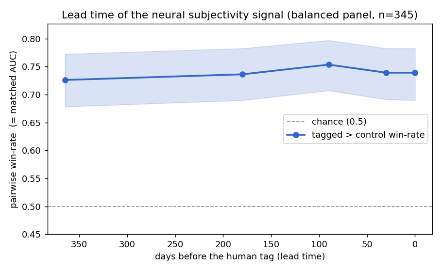
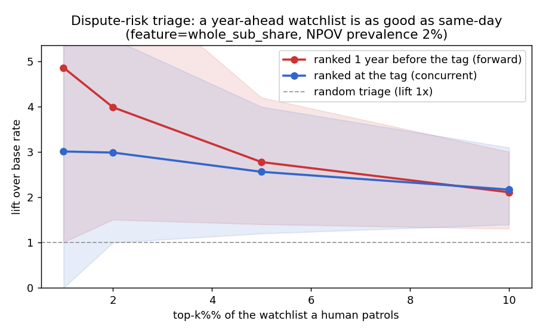
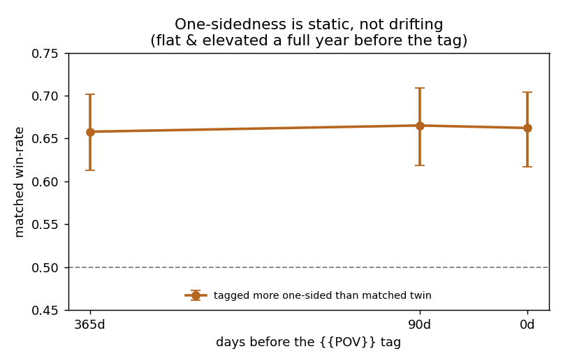

# WikiNPOV Drift Detector

Measuring whether Wikipedia articles can be seen *drifting* away from a
[neutral point of view](https://en.wikipedia.org/wiki/Wikipedia:Neutral_point_of_view)
(NPOV) before an editor flags them — and what the data actually says when you build the
evaluation honestly.

A research project by **Mahima Agarwal** ([@mahi01agarwal](https://github.com/mahi01agarwal),
`User:AgarwalMahima`) and **Dev** ([@mishradev1](https://github.com/mishradev1),
`Devdoingdev`)
Tracking task: [phab:T428896](https://phabricator.wikimedia.org/T428896).

---

## The short version

The task was originally posed as *drift detection*: catch an article as it slides away
from neutrality. We built a dated benchmark first, then tested one signal at a time against
it. The result reframes the problem:

> **Flagged articles don't drift — they start out different.** An article that later gets
> an NPOV tag already reads as more subjective than a matched, never-tagged twin a **full
> year** before any human flags it, and that gap stays **flat** right up to the tag. The
> text is a *static property* of dispute-prone articles, not a changing warning sign. What
> moves around the time of a dispute is **editor activity**, not the prose.

That makes the text a **risk factor you can triage on in advance**, not a drift detector.



---

## The pipeline

Each stage tests one question on the same matched dataset. Stages 1–2 are Jupyter
notebooks (built for [PAWS](https://paws.wmcloud.org)); 3–6 are scripts.

| Stage | Code | Question | Headline result |
|---|---|---|---|
| **NB1** Ground truth | [`notebooks/01_ground_truth.ipynb`](notebooks/01_ground_truth.ipynb), `full_localise.py` | When exactly was each article tagged? | ~2,000 events pinned to a single revision by binary search over history |
| **NB1b** Controls | `build_controls.py` | What's a fair comparison article? | Topically matched, never-tagged, activity-matched so it isn't dormant |
| **NB2** Floor | [`notebooks/02_null_model.ipynb`](notebooks/02_null_model.ipynb), `run_nb2.py` | How far does edit *behaviour* alone get you? | **AUC ≈ 0.76** from metadata only — the bar any text signal must beat |
| **NB3** Content | `build_text_features.py`, `score_bias_gpu.py`, `run_nb3.py`, `nb3_paired_delta.py` | Does the *text* add anything at tag time? | Neural subjectivity adds **+0.034** over the floor; lexicon features add nothing |
| **NB4** Lead time | `build_leadtime_text.py`, `run_nb4.py` | Does the text signal rise *before* the tag? | **No** — flat at ~0.73 from 365 days out to the tag |
| **NB4b** Section level | `build_sections.py`, `score_sections_gpu.py`, `run_sections_size.py`, `run_nb4_sections.py` | Does one *section* drift even if the article doesn't? | No bloat by volume; the hottest section is a strong static trait but its drift is null |
| **NB-dir** Direction axis | `build_direction_input.py`, `score_direction.py`, `run_nb4_direction.py` | Does *one-sidedness* (due weight, not tone) drift before the tag? | **No** — tagged reads +0.12–0.14 more one-sided than its matched twin a year out, and stays flat to the tag |
| **NB6** Watchlist | `run_watchlist.py` | Is it useful as triage? | Ranking a year ahead concentrates future-tagged articles ~**4–5× over base rate** at the top |



### A second, independent construct: direction (one-sidedness)

Subjectivity measures *tone* ("does it read loaded?"). A separate question is *one-sidedness* —
whether an article represents the relevant viewpoints proportionally, or leans one way by
emphasis and omission (due weight). We scored every snapshot with an LLM judge instructed to
rate **balance only, ignoring tone**, and ran the identical lead-time test. The answer is the
same: a later-tagged article already reads as more one-sided than its matched twin a full year
out, with **no rise toward the tag** (difference-in-differences +0.02, 95% CI [-0.003, 0.043]).
Bias *direction*, like bias *tone*, is a **static property** of dispute-prone articles, not a
drift signal — a finding that converges with independent work in the Wikimedia Research team's
NPOV workstream ([phab:T433445](https://phabricator.wikimedia.org/T433445)).



---

## The dataset ("NPOV-Onset")

`npov_data/full_npov_events_en.csv` + `full_npov_controls_en.csv`: roughly two thousand
English NPOV-dispute events, each dated to the exact revision that introduced the tag, each
paired with a matched control. Building it surfaced three measurement pitfalls that any
study of maintenance templates inherits:

1. **Bot backdating.** ~26% of dated maintenance templates are placed by a bot, so dating an
   event by the template alone measures the bot's run, not the dispute.
2. **Edit-summary recall.** Regexes over edit summaries recover only ~53% of human template
   additions — a biased ground truth if used alone.
3. **Dormant controls.** Matching controls on lifetime totals leaves them inactive in the
   window a detector actually examines, which inflates results.

Everything derives from public Wikipedia revisions, collected **read-only** through the
[MediaWiki Action API](https://www.mediawiki.org/wiki/API:Main_page). The code never logs in
and never edits any wiki.

---

## Running it

```bash
pip install -r requirements.txt
```

Scripts read and write under `./npov_data/` and cache every API response under
`./npov_cache/` (set `NPOV_ROOT` or edit `ROOT` at the top of a script to relocate). Caching
means interrupted runs cost nothing on restart. A transient API failure is **never** written
to the cache as a feature value — only real responses are cached, and transient errors are
retried.

The neural subjectivity scoring (`score_bias_gpu.py`, `score_sections_gpu.py`) uses a
Wiki-Neutrality-Corpus-trained classifier and benefits from a GPU; it auto-selects CUDA →
Apple MPS → CPU.

A typical order: `full_localise.py` → `build_controls.py` → `run_nb2.py` →
`build_text_features.py` → `score_bias_gpu.py` → `run_nb3.py` → `build_leadtime_text.py` →
`score_bias_gpu.py` → `run_nb4.py` → `build_sections.py` → `score_sections_gpu.py` →
`run_sections_size.py` → `run_nb4_sections.py` → `run_watchlist.py`.

---

## Layout

```
notebooks/   NB1 (ground truth) and NB2 (null model) as Jupyter notebooks
*.py         NB1b–NB6 pipeline scripts
npov_data/   dataset, per-stage feature tables, result curves and figures
```

Large intermediate files (per-sentence dumps, the API cache, logs) are not tracked; they
regenerate from the scripts.

---

## License

Code is released under the MIT License (see [`LICENSE`](LICENSE)). The dataset is derived
from Wikipedia and is therefore available under
[CC BY-SA 4.0](https://creativecommons.org/licenses/by-sa/4.0/), consistent with its source.
